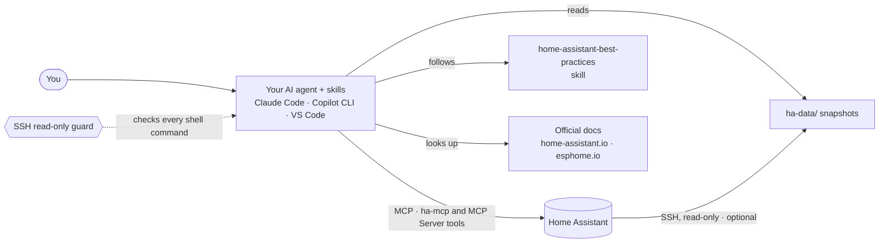
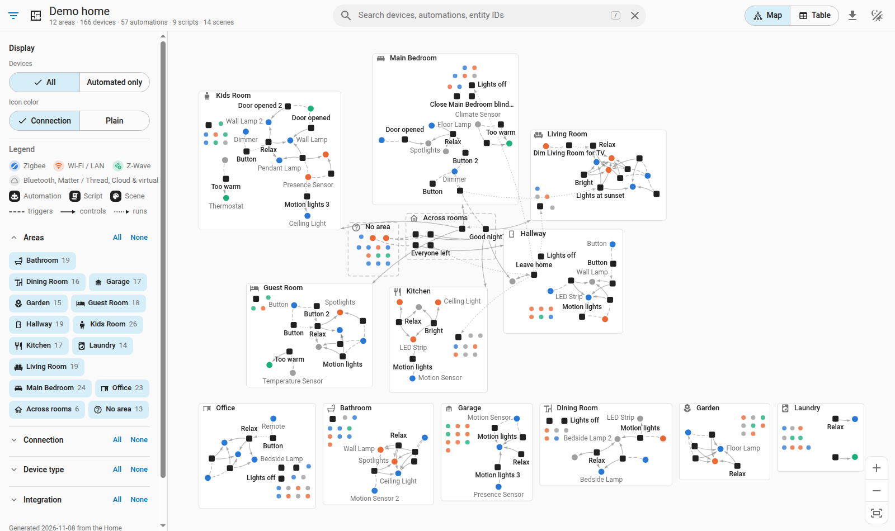
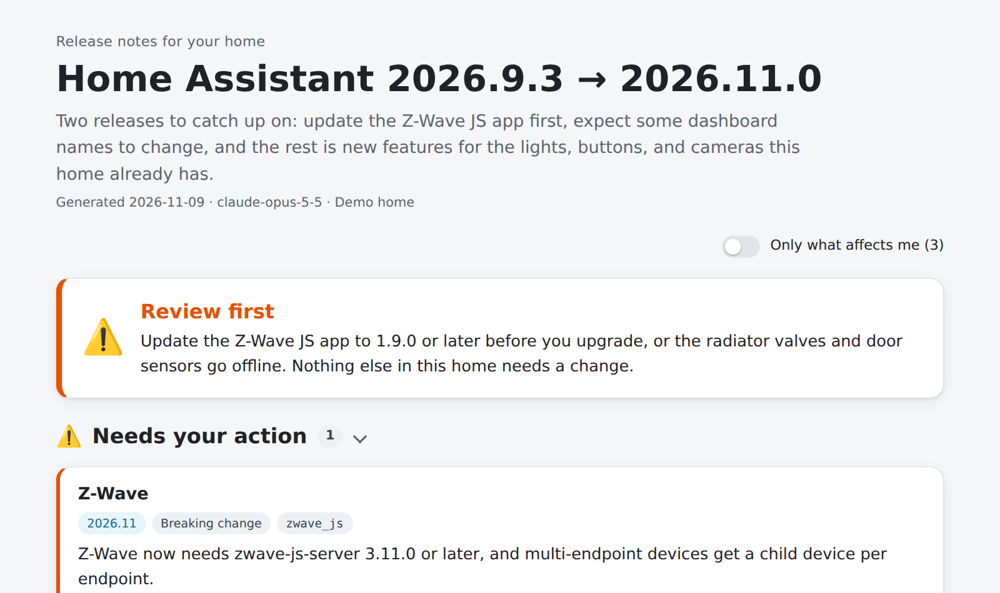

# 🏠 Home Assistant Assistant

<p align="center">
  
</p>

<p align="center">
  <a href="https://github.com/calexandre/homeassistant-assistant/actions/workflows/tests.yml"></a>
  <a href="LICENSE"></a>
  <a href=".claude-plugin/plugin.json"></a>
  <a href="https://www.home-assistant.io/integrations/mcp_server/"></a>
  <a href="https://calexandre.github.io/homeassistant-assistant/"></a>
</p>

> Your Home Assistant setup, understood by AI — grounded in your **live entities** and the **official docs**, not guesses.

Skills and a safety hook for **Claude Code**, **GitHub Copilot CLI**, and **VS Code with GitHub Copilot** that help you run your existing Home Assistant installation: ESPHome configs, troubleshooting, read-only config snapshots, a map of your home, and release notes checked against it. It is not for Home Assistant core development.

It builds on two projects you install alongside it: [ha-mcp](https://github.com/homeassistant-ai/ha-mcp), whose tools let the agent read and change your home, and the [Home Assistant best-practices skill](https://github.com/homeassistant-ai/skills), which tells it how to write automations, scripts, scenes, helpers, and dashboards. This plugin covers what they leave out.

Try what the skills make, on a made-up home, in the [live demos](https://calexandre.github.io/homeassistant-assistant/).

## 📚 Contents

- [✨ Features](#-features)
- [🧭 How it works](#-how-it-works)
- [🧰 Prerequisites](#-prerequisites)
- [🔗 Set up the Home Assistant MCP server](#-set-up-the-home-assistant-mcp-server)
- [📦 Installation](#-installation)
- [✅ Check that it works](#-check-that-it-works)
- [📂 Optional: SSH snapshots](#-optional-ssh-snapshots)
- [💡 Usage examples](#-usage-examples)
- [🏡 Home map](#-home-map)
- [📰 Release notes](#-release-notes)
- [🔒 Safety and privacy](#-safety-and-privacy)
- [🧱 Project structure](#-project-structure)
- [🧯 Troubleshooting](#-troubleshooting)
- [🤝 Contributing](#-contributing)
- [📄 License](#-license)

## ✨ Features

- 🔧 **ESPHome support** — device YAML authoring backed by an esphome.io sitemap, with live reads, validation, and flashing through the ESPHome Device Builder.
- 🩺 **Troubleshooting playbook** — follows the evidence through logs, automation traces, and integration diagnostics before proposing a fix.
- 📰 **Personalized release notes** — `/ha-release-notes` checks every release between your version and the newest against your integrations and automations, and gives an upgrade verdict. [See it](#-release-notes).
- 🏡 **Home map** — `/ha-home-map` draws an interactive map of your areas, devices, and the automations, scripts, and scenes that link them, as one HTML file that works offline. [See the demo](#-home-map).
- 📂 **Config snapshots** — optional read-only SSH snapshots of what no MCP tool reads: `configuration.yaml` and the files it includes, `customize.yaml`, and Zigbee2MQTT data.
- 🔐 **Read-only SSH guard** — a hook that blocks destructive SSH commands against your Home Assistant host, whether they run in Bash or PowerShell.
- 🧩 **Cross-tool plugin** — the same skills and hook work in Claude Code, GitHub Copilot CLI, and VS Code.

## 🧭 How it works



ha-mcp and the best-practices skill handle everyday requests: finding entities, and writing or fixing automations, scripts, scenes, helpers, and dashboards. This plugin's skills load when a request reaches past them:

| Skill | What it does |
|---|---|
| `ha-troubleshooting` | Follows the evidence through logs, traces, and integration diagnostics when something fails, and sorts out MCP connection problems |
| `ha-config-fetch` | Refreshes `ha-data/` snapshots over SSH for the files no MCP tool reads, when they are older than 24 hours and always before debugging |
| `ha-release-notes` | On demand only (`/ha-release-notes`): checks every release from your version up to the target against your setup, and saves an HTML and Markdown report with an upgrade verdict |
| `ha-home-map` | On demand only (`/ha-home-map`): draws your areas, devices, automations, scripts, and scenes as an offline, interactive map |
| `esphome` | Authors ESPHome device YAML with an esphome.io sitemap |

## 🧰 Prerequisites

| You need | For |
|---|---|
| Home Assistant 2026.11 or later with the [Model Context Protocol Server](https://www.home-assistant.io/integrations/mcp_server/) integration (the first release with the complete OAuth support browser sign-in relies on: Client ID Metadata Documents, PKCE, and discovery for public clients) | Everything |
| One client: [Claude Code](https://claude.com/product/claude-code), [GitHub Copilot CLI](https://docs.github.com/en/copilot/concepts/agents/about-plugins), or VS Code with GitHub Copilot | Everything |
| Python 3 | The SSH read-only guard hook, which every client runs |
| [ha-mcp](https://github.com/homeassistant-ai/ha-mcp), installed as the **HA-MCP** integration | Recommended: [reading and changing](#add-ha-mcp) automations, scripts, scenes, dashboards, helpers, and integrations, and reading logs, traces, and history |
| The [`home-assistant-best-practices`](https://github.com/homeassistant-ai/skills) skill | Recommended: writing automations, scripts, scenes, helpers, and dashboards the way Home Assistant recommends; the [Installation](#-installation) commands add it |
| A Home Assistant administrator account, and the **ESPHome Device Builder** add-on for the ESPHome tools | ha-mcp, and the optional [extra tool sets](#optional-extra-tool-sets) for live ESPHome YAMLs and a merged log timeline over MCP |
| SSH access to the Home Assistant host through a passwordless host alias named exactly `homeassistant` in `~/.ssh/config` | Optional: [snapshots](#-optional-ssh-snapshots) of config files and Zigbee2MQTT data, and your own home map |
| [PyYAML](https://pypi.org/project/PyYAML/) or [uv](https://docs.astral.sh/uv/) | Optional: the home map |

Claude Code runs the hook as `python3` on every platform, including Windows. The Copilot clients run it as `python3` on Linux/macOS and as `python` on Windows.

## 🔗 Set up the Home Assistant MCP server

1. In Home Assistant, go to **Settings → Devices & services → Add Integration**, search for **Model Context Protocol Server**, and finish the setup flow.
2. Go to **Settings → Voice assistants → Expose** and expose the entities you want the default **Device control** tools to see. Those tools see only exposed entities; ha-mcp's tools see all of them.
3. Note your MCP URL: your Home Assistant URL followed by `/api/mcp`, for example `https://example.ui.nabu.casa/api/mcp`.

All three clients sign in through Home Assistant's own login page in your browser (OAuth), so there is no token to create or copy. Use an HTTPS URL that matches the **Internal URL** or **External URL** configured in Home Assistant (Home Assistant Cloud, a reverse proxy, or Home Assistant's own TLS): the Home Assistant docs note that Claude Code only connects to MCP servers over HTTPS.

The integration's options control which tools it exposes and whether it requires an administrator account (on by default). See the [integration docs](https://www.home-assistant.io/integrations/mcp_server/) for the details.

### Add ha-mcp

[ha-mcp](https://github.com/homeassistant-ai/ha-mcp) gives the agent tools to read and change automations, scripts, scenes, dashboards, helpers, and integrations, and to read logs, traces, and history, for every entity rather than only the exposed ones.

1. Install the **HA-MCP** integration from the Marketplace and add it under **Settings → Devices & services**, as the [ha-mcp README](https://github.com/homeassistant-ai/ha-mcp) describes.
2. In its options, turn on its LLM API (`enable_llm_api`). The Model Context Protocol Server integration then serves ha-mcp's tools on the same `/api/mcp` URL as its own, as long as **Expose all AI tools** is on or HA-MCP is picked under **AI tools** (see the next section).
3. Reconnect your client so it loads the new tools: `/mcp` → **Reconnect** in Claude Code, or restart the client.

ha-mcp lists its most-used tools directly and finds the rest through `ha_search_tools`. It has its own read-only mode and per-tool approval settings; see its README.

### Optional: extra tool sets

The Model Context Protocol Server integration has two more tool sets of its own. ha-mcp covers most of the **Home Assistant** set, but the **ESPHome Device Builder** set is the only way to read, validate, and flash ESPHome YAMLs over MCP:

| Tool set | What the agent gets | Needs in Home Assistant |
|---|---|---|
| **Device control** | `GetLiveContext` and the device intents (`HassTurnOn`, `HassLightSet`, and so on), for exposed entities only | Nothing beyond the setup above |
| **Home Assistant** | Logs (Core, Supervisor, and add-ons), long-term statistics, templates, search across entities, automations, and labels, integration status, and any action | An administrator account |
| **ESPHome Device Builder** | Device YAMLs: list, read, and validate them, and also edit, compile, and flash | The **ESPHome Device Builder** add-on, and an administrator account |

To get them on the `/api/mcp` URL the clients use, open the integration's options (the gear next to the main URL):

1. Turn on **Expose all AI tools**, or pick the sets under **AI tools**. New setups have it on; setups created before the option existed keep it off.
2. Sign in as an administrator. With the **Home Assistant** set on the main URL, an administrator account is always required.
3. Optionally turn on **Read-only** to keep only the tools that change nothing. That also removes the device intents, such as `HassTurnOn`.
4. Reconnect your client so it reloads the tool list: `/mcp` → **Reconnect** in Claude Code, or restart the client.

Each set also has its own URL under `/api/mcp/`. Those URLs ignore the options above and are never read-only.

## 📦 Installation

Pick your client. All three load the same skills and hook, and add the best-practices skill next to them.

### 🤖 Claude Code

```bash
claude plugin marketplace add calexandre/homeassistant-assistant
claude plugin install homeassistant-assistant@homeassistant
claude plugin marketplace add homeassistant-ai/skills
claude plugin install home-assistant-skills@home-assistant-skills
claude mcp add --scope user --transport http homeassistant https://YOUR-HOME-ASSISTANT/api/mcp
claude mcp login homeassistant
```

`claude mcp login` opens your browser to sign in to Home Assistant.

### 🐙 GitHub Copilot CLI

```bash
copilot plugin marketplace add calexandre/homeassistant-assistant
copilot plugin install homeassistant-assistant@homeassistant
copilot mcp add --transport http homeassistant https://YOUR-HOME-ASSISTANT/api/mcp
npx skills add homeassistant-ai/skills -g
```

Copilot CLI signs in to Home Assistant through your browser, like Claude Code. The `npx skills` installer needs [Node.js](https://nodejs.org/) 22.20 or later.

### 🖥️ VS Code

```bash
git clone https://github.com/calexandre/homeassistant-assistant.git
npx skills add homeassistant-ai/skills -g
code homeassistant-assistant
```

Skills load automatically from [.claude/skills/](.claude/skills/), the best-practices skill from your user folder, and the SSH guard hook from [.github/hooks/](.github/hooks/). Run **MCP: Add Server**, choose **HTTP**, enter `https://YOUR-HOME-ASSISTANT/api/mcp`, use the ID `homeassistant`, and sign in to Home Assistant when VS Code opens your browser.

## ✅ Check that it works

Ask a question only your house can answer:

```text
> Which lights are on right now?
```

The answer should name your real entities. If the agent says it cannot reach Home Assistant, list your MCP servers with `claude mcp list`, `copilot mcp list`, or the **MCP: List Servers** command in VS Code, then see [Troubleshooting](#-troubleshooting).

## 📂 Optional: SSH snapshots

ha-mcp reads automations, scripts, scenes, logs, and the registries live, but no MCP tool reads `configuration.yaml`, the files it includes, `customize.yaml`, or Zigbee2MQTT's files. With SSH access, the agent pulls read-only snapshots of these into `ha-data/` in your working directory (gitignored in this repo), along with the registries and YAML the home map and release notes read, and ESPHome YAMLs and logs for clients without the MCP tools for them.

> [!IMPORTANT]
> SSH access requires a host alias named exactly `homeassistant` in `~/.ssh/config`. The fetch script connects to that name, and the read-only guard only protects commands that target it: under any other alias, snapshots fail and the guard can't block writes to your host.

| Snapshot | Path on the host | Needs |
|---|---|---|
| `automations`, `scenes`, `scripts`, `configuration`, `customize` YAML | `/config` | Any SSH add-on |
| Every file `configuration.yaml` includes, such as packages and automation folders (`secrets.yaml` is always skipped) | `/config` | Any SSH add-on |
| Area, device, entity, and integration registries, trimmed as they download: no credentials, integration titles, MAC addresses, or serial numbers | `/config/.storage` | Any SSH add-on |
| ESPHome device YAMLs (`secrets.yaml` is always skipped) | `/config/esphome` | Any SSH add-on |
| Zigbee2MQTT `configuration`, `devices`, `groups`, `state.json` | `/share/zigbee2mqtt` | Root, or a user with `sudo` |
| Core and Supervisor logs, last 12 hours | Docker container logs | **Advanced SSH & Web Terminal** add-on with **Protection mode** off |

1. Install an SSH add-on in Home Assistant and add your public key to it. The official **Terminal & SSH** add-on covers config files and ESPHome YAMLs; the community **Advanced SSH & Web Terminal** add-on with protection mode off covers everything.
2. Add the `homeassistant` host alias to `~/.ssh/config`, with `HostName`, `User`, and `Port` set to your Home Assistant host and what your add-on uses:

   ```text
   Host homeassistant
     HostName homeassistant.local
     User root
     Port 22
     IdentityFile ~/.ssh/id_ed25519
   ```

3. Check that it logs in without a password prompt:

   ```bash
   ssh homeassistant ls /config
   ```

4. Ask the agent to "refresh my Home Assistant data", or run the script yourself from a clone of this repo:

   ```bash
   .claude/skills/ha-config-fetch/fetch-ha-data.sh
   ```

The script reads `/config` by default. If your add-on mounts the config elsewhere, pass the path: `.claude/skills/ha-config-fetch/fetch-ha-data.sh /homeassistant`.

## 💡 Usage examples

Just ask, in any client. In VS Code, use Chat in Agent mode.

### 🤖 Creating automations

```text
> Create an automation that turns on the living room lights at sunset,
  but only if someone is home.

> Turn my kitchen ceiling switch into a scene that also dims the hall lights.
```

With ha-mcp, the agent writes the automation into Home Assistant once you approve the tool call, following the best-practices skill. Without it, you get the config to paste into the automation editor.

### 🩺 Debugging

```text
> My motion sensor automation isn't triggering — help me debug it.

> Why does this template return unknown? {{ states('sensor.temperature') | float }}
```

The troubleshooting skill reads the logs, the automation's traces, and the integration's diagnostics before proposing a fix.

### 📊 Checking your home

```text
> Which battery sensors are below 20%?

> Are any of my automations using deprecated syntax?
```

### 🔧 ESPHome devices

```text
> Add a BME280 sensor to the hall corridor wall switch over I2C.
```

For what an upgrade means for your home, see [Release notes](#-release-notes).

## 🏡 Home map

`/ha-home-map` draws your home as one interactive page: each area is a card holding its devices, linked to the automations, scripts, and scenes that trigger or control them. The page is a single HTML file that opens straight from disk, with no server or internet connection.

[](https://calexandre.github.io/homeassistant-assistant/home-map.html)

**Try it first:** the [live demo](https://calexandre.github.io/homeassistant-assistant/home-map.html) maps a made-up home with 12 rooms, 166 devices, and 57 automations, right in your browser.

### Build your map

The map reads your registries and automation YAML from [SSH snapshots](#-optional-ssh-snapshots), and its graph builder needs [PyYAML](https://pypi.org/project/PyYAML/) or [uv](https://docs.astral.sh/uv/). Run it in Claude Code, with an optional page title:

```text
/ha-home-map
/ha-home-map Beach house
```

It runs only when you call it, and then:

1. Refreshes `ha-data/` over SSH when the snapshot is more than a day old, including every file `configuration.yaml` includes.
2. Saves the map to `.temp/home-map/home-map.html` (gitignored).
3. Replies with a link to the file (on WSL, also a `file://wsl.localhost/…` address for your Windows browser), counts of what's on the map, and the automations it left off because they touch no device.

Without SSH access, it hands you the demo instead: the plugin ships it already built, so it needs no build and no PyYAML. Once your map exists, ask follow-up questions such as "what turns on the hallway light?": the agent answers from the map's data in `.temp/home-map/graph.json`.

The page lists your rooms, devices, and routines, so it stays on your machine and the agent shares only its local path. What the agent reads to answer you, its counts and the parts of `graph.json` a follow-up question needs, reaches your AI provider like any other snapshot; [Safety and privacy](#-safety-and-privacy) covers that and the one network request a build makes.

### Read the map

| You see | It means |
|---|---|
| Card | An area. **Across rooms** holds the automations, scripts, and scenes that touch several areas, and **No area** holds devices without one |
| Round icon | A device, colored by how it connects: Zigbee, Wi-Fi, Z-Wave, and so on |
| Dark square | An automation, script, or scene |
| Dashed line | Triggers: the device starts the automation |
| Solid arrow | Controls: the automation, script, or scene acts on the device |
| Dotted arrow | Runs: an automation or script starts another automation, script, or scene |

### Find your way around

- **Search** by name or entity ID, or press `/` to jump to the search box.
- **Click** an item to highlight everything linked to it and open its details: what triggers it, what it controls, and what it runs. `Esc` clears the selection.
- **Filter** by area, connection, device type, or integration in the sidebar: click a chip to show or hide it, or double-click it to show only that one. **Automated only** hides devices that no automation touches.
- **Zoom** with the scroll wheel, a pinch, a double-click, or `+` and `-`; drag or use the arrow keys to pan, and press `0` to fit the whole home.
- **Switch to Table** for a sortable list, **download** the current view as a PNG, or switch between light and dark.

## 📰 Release notes

`/ha-release-notes` tells you what an upgrade means for your home: every release between the version you run and the one you want, checked against your integrations and automations, with a verdict on whether to upgrade.

[](https://calexandre.github.io/homeassistant-assistant/release-notes.html)

**Try it first:** the [live demo](https://calexandre.github.io/homeassistant-assistant/release-notes.html) checks a made-up home's upgrade from 2026.9.3 to 2026.11.0.

### Check your upgrade

Run it in Claude Code, optionally with the release you want and the version you run:

```text
/ha-release-notes
/ha-release-notes 2026.11.1
/ha-release-notes 2026.11.1 from 2026.9.3
```

It runs only when you call it, and then:

1. Reads your installed version, registries, and YAML from the [SSH snapshots](#-optional-ssh-snapshots), refreshing them when they are more than a day old.
2. Fetches the official release post of every release from your version up to the target (the newest, unless you name one), and matches each highlight, new integration, improvement, breaking change, and patch fix to the integrations and automations that use them.
3. Has the agent judge what matched, in its own words, and pick a verdict: ✅ Upgrade, ℹ️ Upgrade and check, ⚠️ Review first, ⏳ Wait for a patch, or 🛑 Hold.
4. Saves the report to `ha-release-notes/ha-release-<version>.html` and `.md` (gitignored), and replies with the changes that affect you, the verdict, and a link to the page.

Without SSH access, it matches the entity domains `GetLiveContext` shows, says so in the report, and covers only the target release unless you pass `from`. The build needs [PyYAML](https://pypi.org/project/PyYAML/) or [uv](https://docs.astral.sh/uv/) to read your YAML.

### Read the report

The page leads with the verdict, then what needs your action, what you'll notice, the highlights, and the new features worth a look. **Only what affects me** hides everything else, and each breaking change that doesn't touch your home gets one line with a link to the post. The Markdown copy holds the same sections, with front matter for notes apps.

## 🔒 Safety and privacy

- **Read-only SSH guard.** A `PreToolUse` hook inspects every Bash and PowerShell command. Commands that reach the `homeassistant` host must match a read-only allowlist; interactive SSH, uploads (`scp`, `sftp`, `rsync`), and everything else are denied. It guards against mistakes; it is not a sandbox.
- **Changes stay with you.** ha-mcp and the [extra tool sets](#optional-extra-tool-sets) can change anything, from editing an automation to flashing an ESPHome device. Your client asks before each MCP tool call, and the skills ask before any tool that changes something. For a hard guarantee, turn on ha-mcp's read-only mode and the Model Context Protocol Server integration's **Read-only** option.
- **What leaves your machine.** Anything the agent reads through MCP (entity states, automations, logs, history, ESPHome YAML), and any snapshot the agent reads (automations, logs, Zigbee2MQTT state, the home map's `graph.json`, the release notes to-do with your matching automations), are sent to your AI provider as part of the conversation. `secrets.yaml` is never fetched, and the registries are trimmed before they are saved, so integration credentials never reach the disk. The home map page stays on your machine; building it fetches only area icons it doesn't bundle, by icon name, from the jsdelivr CDN. Release notes fetch only the public release posts, from GitHub and the Home Assistant blog feed, and send nothing about your home.
- **No tokens to handle.** Every client signs in through Home Assistant's own login page, so there is no access token to copy, paste, or leak.

## 🧱 Project structure

```text
.claude-plugin/
├── plugin.json                  # Plugin manifest (Claude Code + Copilot CLI): version, skills path
├── marketplace.json             # Marketplace entry used by `plugin marketplace add`
└── icon.png                     # Plugin icon
.claude/skills/                  # Every skill, in the one folder all three clients read
├── ha-config-fetch/             # fetch-ha-data.sh (SSH snapshots) and its helpers
├── ha-home-map/                 # /ha-home-map, on demand only: graph builder and page template
├── ha-release-notes/            # /ha-release-notes, on demand only: release post parser, matcher, and report page
├── ha-troubleshooting/          # Logs, traces, diagnostics, and MCP connection problems
└── esphome/                     # ESPHome YAML guidance and SITEMAP.md of esphome.io
hooks/hooks.json                 # SSH read-only guard config for plugin installs
.github/
├── hooks/                       # SSH read-only guard script, its tests, and its config for clones
├── instructions/                # Markdown rules for docs and generated reports
├── workflows/tests.yml          # CI: runs every test suite on pushes to main and on pull requests
├── workflows/pages.yml          # Publishes demo/assets/ to GitHub Pages, stamped with the plugin version
└── dependabot.yml               # Weekly updates for the GitHub Actions in workflows/
tests/                           # Test suites for the skills, one folder per skill, kept out of the skill folders
demo/
├── demo_home.py                 # Generates made-up homes for the demos and the tests
├── release-notes.json           # The made-up home's release notes report, the source of its demo page
├── trim_release_report.py       # Trims a judged report into release-notes.json
├── build.sh                     # Rebuilds the demo pages; CI fails while a committed page is stale
└── assets/                      # GitHub Pages root: the showcase (index.html), each demo built, and its screenshot
images/                          # README logo
AGENTS.md                        # Instructions for coding agents working on this repo
CONTRIBUTING.md                  # Tests, version bumps, and commit style for contributors
SECURITY.md                      # How to report a vulnerability privately
LICENSE                          # MIT
ha-data/                         # Fetched HA snapshots and logs (gitignored)
ha-release-notes/                # Generated release reports (gitignored)
.temp/                           # Scratch output (gitignored)
```

## 🧯 Troubleshooting

**The agent can't reach Home Assistant:**

1. Check the server's status with `claude mcp list`, `copilot mcp list`, or **MCP: List Servers** in VS Code.
2. Check that the URL ends in `/api/mcp`, uses the right scheme (`https://` for Claude Code), and opens from this machine.
3. If sign-in fails or you get `401 Unauthorized`, check that the URL matches the **Internal URL** or **External URL** configured in Home Assistant, then sign in again (`claude mcp login homeassistant` in Claude Code). The integration docs' [troubleshooting section](https://www.home-assistant.io/integrations/mcp_server/#troubleshooting) covers the remaining OAuth cases.
4. The integration requires an administrator account by default, so signing in as a non-admin user fails. Sign in as an administrator or change that option in the integration.

**The agent says a device doesn't exist:** ha-mcp's tools see every entity, so check that they're connected (next item). Without ha-mcp, expose the device under **Settings → Voice assistants → Expose**: the **Device control** tools see only exposed entities.

**ha-mcp, log, statistics, or ESPHome tools are missing:** check ha-mcp's LLM API option ([Add ha-mcp](#add-ha-mcp)) and the integration's options and add-ons against [Optional: extra tool sets](#optional-extra-tool-sets), then reconnect your client. Clients load the tool list when they connect, so new sets appear only after a reconnect.

**The plugin doesn't load in Claude Code or Copilot CLI:**

```bash
claude plugin marketplace update homeassistant
claude plugin list
copilot plugin marketplace update homeassistant
copilot plugin list
```

From a local clone, validate the manifests with `claude plugin validate .`.

**SSH snapshots fail:** run `ssh homeassistant ls /config` first. If that works but Zigbee2MQTT data or logs are skipped, check the [snapshot table](#-optional-ssh-snapshots) for the access each one needs.

**Shell commands fail with an SSH guard hook startup error:**

Confirm Python is available: run `python3 --version` for Claude Code on any platform and for Copilot on Linux/macOS, or `python --version` for Copilot on Windows. On Windows, a `python3` or `python` command that only opens the Microsoft Store is an app execution alias, not an interpreter; install Python or turn the alias off in **Settings → Apps → Advanced app settings → App execution aliases**. The hook uses separate PowerShell and Bash launchers and inspects both the Bash and PowerShell tools; restart the client after changing hook configuration so it reloads. All Git subcommands, including `commit` and `push`, are allowed by this hook; the read-only restrictions apply only to direct SSH/file-transfer commands targeting `homeassistant`.

## 🤝 Contributing

Questions and ideas are welcome in [Discussions](https://github.com/calexandre/homeassistant-assistant/discussions); bugs go to [Issues](https://github.com/calexandre/homeassistant-assistant/issues). See [CONTRIBUTING.md](CONTRIBUTING.md) for how to test changes, and [SECURITY.md](SECURITY.md) to report a vulnerability privately.

## 📄 License

[MIT](LICENSE)

## 📖 Resources

- [Home Assistant docs](https://www.home-assistant.io/docs/)
- [Model Context Protocol Server integration](https://www.home-assistant.io/integrations/mcp_server/)
- [ha-mcp](https://github.com/homeassistant-ai/ha-mcp)
- [Home Assistant agent skills](https://github.com/homeassistant-ai/skills)
- [ESPHome docs](https://esphome.io/)
- [Claude Code plugins](https://code.claude.com/docs/en/plugins-reference)
- [GitHub Copilot](https://docs.github.com/en/copilot)
- [Model Context Protocol](https://modelcontextprotocol.io/)
